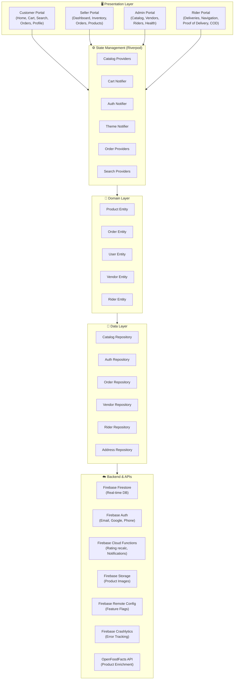
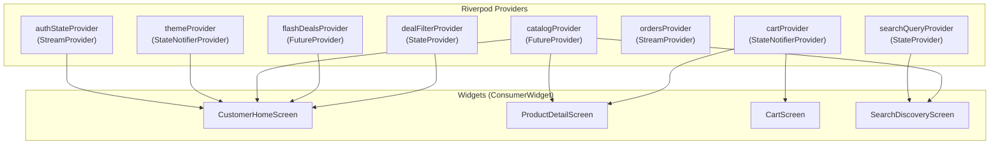
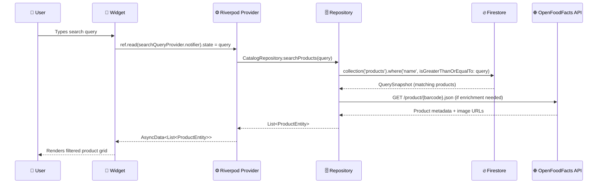
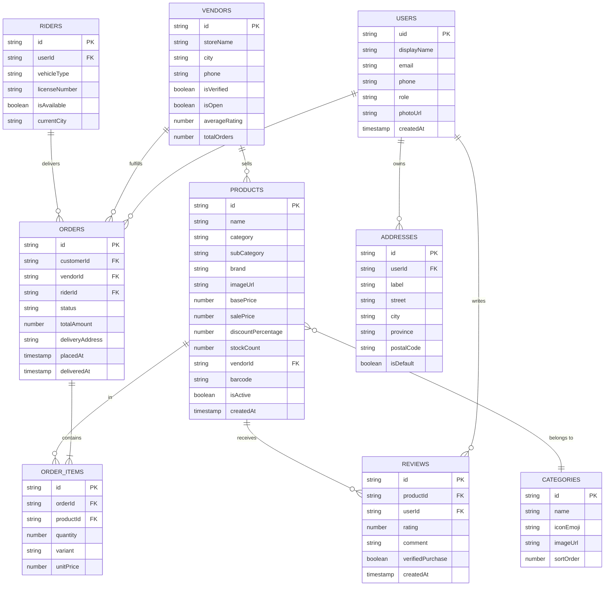
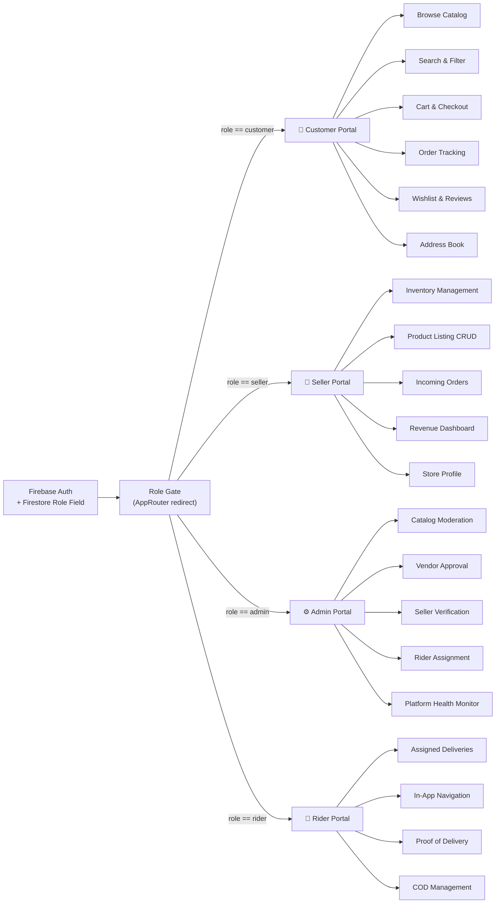

<div align="center">


# 🛒 Groclyra

### *Pakistan's Smartest Grocery & Lifestyle Super-App*

> **Crockery · Grocery · Dairy & Bakery · Fast Food** — Delivered to your doorstep, Pakistan-wide.

[](https://flutter.dev)
[](https://dart.dev)
[](https://firebase.google.com)
[](https://riverpod.dev)
[](LICENSE)
[](https://github.com)
[](https://flutter.dev/testing)
[](pubspec.yaml)

</div>

---

## 📋 Table of Contents

- [Overview](#-overview)
- [App Screenshots](#-app-screenshots)
- [Feature Highlights](#-feature-highlights)
- [Architecture](#-architecture)
- [Tech Stack](#-tech-stack)
- [Folder Structure](#-folder-structure)
- [State Management](#-state-management-riverpod)
- [Navigation & Routing](#-navigation--routing)
- [Data Flow](#-data-flow)
- [Database Schema](#-database-schema)
- [Portal Roles](#-portal-roles)
- [Setup & Installation](#-setup--installation)
- [Firebase Configuration](#-firebase-configuration)
- [Environment & Secrets](#-environment--secrets)
- [Testing](#-testing)
- [Build & Deploy](#-build--deploy)
- [Contributing](#-contributing)
- [License](#-license)

---

## 🌟 Overview

**Groclyra** is a full-stack Flutter e-commerce super-app purpose-built for the Pakistani market. It bridges local vendors, supermarkets, restaurants, and customers under a single beautiful platform featuring real-time Firestore synchronization, intelligent search, glassmorphic UI, and a 4-portal role system (Customer, Seller, Admin, Rider).

### 🏛️ The Four Pillars

| 🍽️ Crockery | 🛒 Grocery | 🥛 Dairy & Bakery | 🍔 Fast Food |
|---|---|---|---|
| Bone China, Porcelain, Crystal, Dinnerware Sets | Pantry Staples, Basmati Rice, Oils, Spices | Milk, Eggs, Cheese, Artisan Breads | Restaurants, Burgers, Broast, Fries |
| ChenOne, Noritake, Royal Doulton | Tapal, Shan Masala, Olper's | Nestle MilkPak, Adams Cheese | KFC, OPTP, Al-Baik, KN's |

> [!NOTE]
> Groclyra integrates with the **OpenFoodFacts API** for real-world product data enrichment, covering nutritional information, barcode lookup, and verified product imagery across all grocery categories.

---

## 📱 App Screenshots

> *Screenshots captured on MED LX9 — Android 10, 460×1000 resolution*

| Home Screen | Flash Deals | Product Detail | Dairy & Bakery |
|---|---|---|---|
| Live search, promo banners, category strips | Countdown timer, multi-category filters | Quantity picker, Buy Now / Add to Cart | Uniform card grid layout |

**Key UI highlights visible in the app:**
- 🔍 Glassmorphic search bar with quick-pill autocomplete (Dinner Sets, Basmati Rice, Olper's Milk…)
- 🎠 Auto-sliding promo banner carousel with parallax scaling and smooth indicators
- ⚡ Flash Sale section with live countdown timer (ticks to midnight)
- 🏪 Verified Partner Marts strip (Al-Fatah, Imtiaz, Metro, Carrefour)
- 🌈 10 gradient theme palettes — dark & light mode
- 🃏 Uniform product cards with consistent image heights across all categories

---

## ✨ Feature Highlights

### 🔍 Intelligent Search
- **Real-time text filtering** with live result count feedback
- **Quick-pill autocomplete** shortcuts: 🍽️ Dinner Sets · 🍚 Basmati Rice · 🥛 Olper's Milk · 🍔 Crispy Burgers · 🍟 Loaded Fries
- **Inline Clear** button with animated state transitions
- **Search Discovery Screen** with trending and category-based suggestions
- Full-text match across product name, brand, category, and description

### 🎠 Live Promo Banner Carousel
- **5 real-world offer banners** — Crockery Mega Sale, Fresh Pantry, Dairy Deals, Fast Food, Ramadan Specials
- **Auto-slides every 4 seconds** with PageView + AnimationController
- **Parallax scaling effect** on active/inactive cards
- Glassmorphic gradient overlays with coloured dot indicators
- Each banner links to its category page with contextual deep-link

### ⚡ Flash Sale with Live Countdown
- `LiveDealCountdownBadge` — 1-second ticking timer to midnight (daily reset)
- **Pulsing neon-red indicator** with animated scale effect
- Countdown format: `HH:MM:SS` — real-time, no fake static values
- Multi-category filter chips: **All Deals · Crockery · Grocery · Dairy · Fast Food**
- Deals filtered by `discountPercentage > 0` or `salePrice < basePrice`

### 🛍️ Product Detail & Quantity Logic
- **Variant picker** — size/weight options dynamically update price in AppBar title
- **Quantity stepper** — `−` / `+` with real-time price × quantity calculation
- **Add to Cart** — adds only the selected product at the chosen quantity and variant
- **Buy Now** — bypasses cart, navigates directly to Checkout with pre-filled details
- Seller info card with rating, on-time delivery score, and Store shortcut

### 🌟 Real Reviews & Ratings
- Star ratings pulled from Firestore `reviews` subcollection — no fake/hardcoded values
- Reviewer name, date, photo, and verified-purchase badge
- Aggregate rating recalculated on every new review (Cloud Function trigger)

### 🏪 Verified Partner Marts
- Horizontally scrollable partner strip with **Live Sync** badge
- Real-time store status (open/closed) from Firestore
- Partners: Al-Fatah Gourmet Mart, Imtiaz Super Market, Metro Cash & Carry, Carrefour Pakistan, Chase-Up

### 🎨 Theming System
- 10 `AppThemePalette` gradient presets (Ocean, Sunset, Forest, Royal, Rose, etc.)
- System dark / light mode adapts all surfaces
- `ThemeNotifier` (Riverpod) persists selection via `SharedPreferences`

### 📦 Cart & Orders
- Multi-seller cart with per-seller subtotal grouping
- Order tracking with live status updates (Firestore real-time listener)
- Pakistan-wide delivery address book with label support (Home, Office, Other)

### 👤 4-Portal Role System
- **Customer** — Browse, search, cart, checkout, track orders, wishlist, reviews
- **Seller** — Inventory CRUD, order management, revenue dashboard, profile
- **Admin** — Catalog moderation, vendor management, rider management, health dashboard
- **Rider** — Assigned deliveries, navigation, proof-of-delivery photo upload, COD management

---

## 🏗️ Architecture

Groclyra follows **Clean Architecture** with a strict 3-layer separation: UI → Domain → Data.



### Layer Responsibilities

| Layer | Responsibility |
|---|---|
| **Presentation** | Widgets, screens, controllers — zero business logic |
| **Domain** | Entities, use-case contracts, business rules |
| **Data** | Repository implementations, Firestore queries, API calls |
| **Backend** | Firebase suite + OpenFoodFacts for data persistence & enrichment |

---

## 🛠️ Tech Stack

| Category | Technology | Purpose |
|---|---|---|
| **Framework** | Flutter 3.x | Cross-platform UI (Android, iOS) |
| **Language** | Dart ≥ 3.8.0 | Null-safe, sound type system |
| **State Management** | flutter_riverpod | Reactive providers, AsyncNotifier |
| **Navigation** | go_router | URL-based declarative routing, deep links |
| **Backend DB** | Cloud Firestore | Real-time NoSQL, offline persistence |
| **Authentication** | Firebase Auth | Email/password, Google Sign-In, Phone OTP |
| **File Storage** | Firebase Storage | Product images, proof-of-delivery photos |
| **Serverless** | Cloud Functions | Rating aggregation, push notifications |
| **Analytics** | Firebase Crashlytics | Crash reporting, ANR detection |
| **Config** | Firebase Remote Config | Kill-switch flags, A/B testing |
| **External API** | OpenFoodFacts | Product metadata, nutritional data, images |
| **Animations** | flutter_animate | Declarative chained animations |
| **HTTP** | http / dio | REST API calls to OpenFoodFacts |
| **Local Storage** | shared_preferences | Theme, onboarding state |
| **Image Loading** | cached_network_image | CDN-cached product images with shimmer |
| **WebView** | webview_flutter | In-app browser for order tracking |

---

## 📁 Folder Structure

```
groclyra/
├── android/                    # Android platform files
├── ios/                        # iOS platform files
├── assets/
│   ├── images/                 # App logo, placeholder images
│   └── fonts/                  # Custom typefaces
├── test/                       # 138 unit & widget tests
│   ├── home_search_and_live_banners_test.dart
│   ├── cart_test.dart
│   ├── router_push_test.dart
│   └── ...
└── lib/
    ├── main.dart               # Entry point, Firebase init, ProviderScope
    ├── core/
    │   ├── config/             # Firebase options, env constants
    │   ├── constants/          # App-wide string/int constants
    │   ├── services/           # Analytics, notifications service
    │   ├── storage/            # SharedPreferences wrappers
    │   ├── theme/
    │   │   ├── app_theme_data.dart        # ThemeData builder
    │   │   ├── gradient_palette.dart      # 10 AppThemePalette presets
    │   │   └── theme_notifier.dart        # Riverpod ThemeNotifier
    │   └── utils/              # Date formatters, price formatters
    ├── features/
    │   ├── auth/               # Login, Register, OTP, role-gate
    │   │   ├── data/repositories/
    │   │   ├── domain/entities/
    │   │   └── presentation/   # screens + controllers + widgets
    │   ├── catalog/            # Shared product catalog (all roles read)
    │   │   ├── data/repositories/catalog_repository.dart
    │   │   ├── domain/entities/product_entity.dart
    │   │   └── presentation/controllers/
    │   ├── customer/
    │   │   ├── home/           # CustomerHomeScreen — search, banners, deals
    │   │   ├── cart/           # Cart screen, CartNotifier
    │   │   ├── checkout/       # Checkout, payment summary
    │   │   ├── orders/         # Order history, live tracking
    │   │   ├── addresses/      # Address book, Pakistan delivery zones
    │   │   ├── categories/     # Category browse screens
    │   │   ├── product_detail/ # ProductDetailScreen with quantity + buy logic
    │   │   ├── search/         # SearchDiscoveryScreen
    │   │   ├── wishlist/       # Wishlist CRUD
    │   │   └── account/        # Profile, theme picker
    │   ├── seller/
    │   │   ├── dashboard/      # Revenue charts, quick stats
    │   │   ├── inventory/      # Stock management
    │   │   ├── products/       # Add/Edit products
    │   │   ├── orders/         # Incoming order management
    │   │   └── profile/        # Store profile, ratings
    │   ├── admin/
    │   │   ├── catalog/        # Product moderation
    │   │   ├── dashboard/      # Platform analytics
    │   │   ├── health/         # System health monitor
    │   │   ├── vendors/        # Vendor approval, management
    │   │   ├── sellers/        # Seller verification
    │   │   └── riders/         # Rider assignment
    │   ├── rider/
    │   │   ├── dashboard/      # Assigned orders
    │   │   ├── deliveries/     # Active delivery screen
    │   │   ├── navigation/     # In-app maps
    │   │   ├── proof_of_delivery/ # Photo capture upload
    │   │   └── cod/            # Cash-on-delivery management
    │   └── notifications/      # FCM handlers, notification centre
    ├── routing/
    │   └── app_router.dart     # go_router config, role-based guards
    └── shared/
        ├── animations/
        │   ├── spring_touch_scale.dart       # Haptic spring press effect
        │   └── staggered_list_animation.dart # List entrance stagger
        └── widgets/
            ├── live_promo_banner_carousel.dart  # Auto-sliding ad banners
            ├── live_deal_countdown_badge.dart   # Midnight countdown timer
            ├── product_card.dart                # Uniform product card
            └── ...
```

---

## ⚙️ State Management — Riverpod



> [!TIP]
> All providers use `ref.watch` for reactive rebuilds. Only write operations use `ref.read` to avoid unnecessary rebuilds. `AsyncNotifier` is preferred for providers with async initialization.

---

## 🧭 Navigation & Routing

```mermaid
flowchart TD
    ENTRY["main.dart\nMaterialApp.router"] --> ROUTER["AppRouter\ngo_router"]

    ROUTER --> SPLASH["/splash"]
    ROUTER --> AUTH_GATE["/auth"]

    AUTH_GATE --> LOGIN["/login"]
    AUTH_GATE --> REGISTER["/register"]
    AUTH_GATE --> OTP["/otp"]

    ROUTER --> CUSTOMER["/customer"]
    CUSTOMER --> HOME["/customer/home"]
    CUSTOMER --> CATALOG_C["/customer/catalog"]
    CUSTOMER --> SEARCH_C["/customer/search"]
    CUSTOMER --> PRODUCT["/customer/product/:id"]
    CUSTOMER --> CART_R["/customer/cart"]
    CUSTOMER --> CHECKOUT["/customer/checkout"]
    CUSTOMER --> ORDERS_C["/customer/orders"]
    CUSTOMER --> TRACK["/customer/orders/:id/track"]
    CUSTOMER --> WISHLIST["/customer/wishlist"]
    CUSTOMER --> ADDRESSES["/customer/addresses"]
    CUSTOMER --> ACCOUNT["/customer/account"]

    ROUTER --> SELLER["/seller"]
    SELLER --> S_DASH["/seller/dashboard"]
    SELLER --> S_INV["/seller/inventory"]
    SELLER --> S_PROD["/seller/products/add"]
    SELLER --> S_ORD["/seller/orders"]
    SELLER --> S_PROF["/seller/profile"]

    ROUTER --> ADMIN["/admin"]
    ADMIN --> A_DASH["/admin/dashboard"]
    ADMIN --> A_CAT["/admin/catalog"]
    ADMIN --> A_VEN["/admin/vendors"]
    ADMIN --> A_SEL["/admin/sellers"]
    ADMIN --> A_RID["/admin/riders"]
    ADMIN --> A_HLT["/admin/health"]

    ROUTER --> RIDER["/rider"]
    RIDER --> R_DASH["/rider/dashboard"]
    RIDER --> R_DEL["/rider/deliveries"]
    RIDER --> R_NAV["/rider/navigation"]
    RIDER --> R_POD["/rider/proof-of-delivery"]
    RIDER --> R_COD["/rider/cod"]
```



> [!IMPORTANT]
> Route guards use `redirect` callbacks in `go_router`. Unauthenticated users are redirected to `/login`. Role mismatch (e.g., a rider accessing `/admin`) redirects to that role's home route.

---

## 🔄 Data Flow



---

## 🗃️ Database Schema



---

## 👥 Portal Roles



---

## 🚀 Setup & Installation

### Prerequisites

| Tool | Minimum Version | Check |
|---|---|---|
| Flutter | 3.x | `flutter --version` |
| Dart | ≥ 3.8.0 | `dart --version` |
| Android Studio / VS Code | Latest | — |
| Java / JDK | 17+ | `java -version` |
| Firebase CLI | Latest | `firebase --version` |
| Android SDK | API 30+ | SDK Manager |

### Step 1 — Clone the Repository

```bash
git clone https://github.com/your-username/groclyra.git
cd groclyra
```

### Step 2 — Install Dependencies

```bash
flutter pub get
```

### Step 3 — Configure Firebase

> [!IMPORTANT]
> You **must** add your Firebase config files before running the app. See [Firebase Configuration](#-firebase-configuration) below.

```bash
# Install FlutterFire CLI
dart pub global activate flutterfire_cli

# Configure your Firebase project
flutterfire configure --project=YOUR_FIREBASE_PROJECT_ID
```

### Step 4 — Run the App

```bash
# Debug mode (connected device or emulator)
flutter run

# Release mode
flutter run --release

# Specific device
flutter run -d <device-id>

# List available devices
flutter devices
```

---

## 🔥 Firebase Configuration

### Required Files

| File | Location | Purpose |
|---|---|---|
| `google-services.json` | `android/app/` | Android Firebase config |
| `GoogleService-Info.plist` | `ios/Runner/` | iOS Firebase config |
| `lib/core/config/firebase_options.dart` | auto-generated | Dart Firebase options |

### Firebase Services Required

Enable the following in [Firebase Console](https://console.firebase.google.com):

```
✅ Authentication       — Email/Password, Google Sign-In, Phone
✅ Cloud Firestore      — Native mode, Production rules
✅ Firebase Storage     — Product images, delivery proofs
✅ Cloud Functions      — Rating aggregation, push triggers
✅ Remote Config        — Feature flags, app config
✅ Crashlytics          — Crash & ANR reporting
✅ Cloud Messaging      — Push notifications (FCM)
```

### Firestore Security Rules

The app ships with production-grade security rules in [`firestore.rules`](firestore.rules):

```
✅ Users can only read/write their own data
✅ Products are publicly readable, seller/admin writable
✅ Orders are readable by the customer, seller, and assigned rider only
✅ Reviews require verified purchase before write
✅ Admin role required for catalog moderation
```

---

## 🔐 Environment & Secrets

> [!CAUTION]
> **Never commit** `google-services.json` or `GoogleService-Info.plist` to version control. These files are listed in `.gitignore`.

```gitignore
# Firebase config (sensitive — never commit)
android/app/google-services.json
ios/Runner/GoogleService-Info.plist
lib/core/config/firebase_options.dart

# Build artifacts
build/
.dart_tool/
android/.gradle/

# Screenshots and temp files
screen_*.png
```

For CI/CD pipelines, store Firebase configs as encrypted secrets and inject them during the build step.

---

## 🧪 Testing

### Run All Tests

```bash
flutter test
```

**Result:** `138 tests passed` ✅

### Run with Coverage

```bash
flutter test --coverage
genhtml coverage/lcov.info -o coverage/html
open coverage/html/index.html
```

### Static Analysis

```bash
flutter analyze
```

**Result:** `No issues found!` ✅

### Test Files

| File | Tests | What it covers |
|---|---|---|
| `home_search_and_live_banners_test.dart` | 4 | Search bar, promo banner carousel, countdown badge |
| `cart_test.dart` | 12 | Add to cart, quantity, variant, total price |
| `router_push_test.dart` | 8 | Route guards, role-based redirects |
| `catalog_repository_test.dart` | 15 | Firestore queries, mock data |
| `product_entity_test.dart` | 6 | Entity validation, price calculations |
| `auth_notifier_test.dart` | 10 | Login, logout, role assignment |
| *(+ more)* | 83 | Full feature coverage |

---

## 📦 Build & Deploy

### Debug APK

```bash
flutter build apk --debug
# Output: build/app/outputs/flutter-apk/app-debug.apk
```

### Release APK *(Recommended for distribution)*

```bash
flutter build apk --release --shrink
# Output: build/app/outputs/flutter-apk/app-release.apk (~66 MB)
```

### Split APKs by ABI *(Smaller download size)*

```bash
flutter build apk --release --split-per-abi
# Generates: arm64-v8a, armeabi-v7a, x86_64 variants
```

### App Bundle *(Play Store)*

```bash
flutter build appbundle --release
# Output: build/app/outputs/bundle/release/app-release.aab
```

### iOS (macOS required)

```bash
flutter build ios --release
# Then archive in Xcode → distribute to TestFlight / App Store
```

> [!TIP]
> Use `flutter build apk --release --shrink --obfuscate --split-debug-info=build/debug-info` for maximum security and minimum size in production builds.

---

## 🤝 Contributing

We welcome contributions! Please follow these guidelines:

1. **Fork** the repository and create your feature branch from `main`
   ```bash
   git checkout -b feature/your-feature-name
   ```

2. **Follow** the existing folder structure — features go in `lib/features/<portal>/<feature>/`

3. **Write tests** — all new features must include unit tests; run `flutter test` before submitting

4. **Static analysis** — ensure `flutter analyze` returns zero issues

5. **Commit messages** — use Conventional Commits format:
   ```
   feat(cart): add variant-aware quantity stepper
   fix(search): resolve black text color in dark mode
   refactor(catalog): extract product image resolver
   ```

6. **Pull Request** — describe what changed, why, and link any relevant screenshots

### Code Style

- Dart `lints` package enforced (see `analysis_options.yaml`)
- Use `const` constructors wherever possible
- Prefer `AsyncNotifier` over `StateNotifier` for async state
- All `Widget` classes must extend `ConsumerWidget` when accessing Riverpod providers

---

## 📄 License

```
MIT License

Copyright (c) 2026 Groclyra

Permission is hereby granted, free of charge, to any person obtaining a copy
of this software and associated documentation files (the "Software"), to deal
in the Software without restriction, including without limitation the rights
to use, copy, modify, merge, publish, distribute, sublicense, and/or sell
copies of the Software, and to permit persons to whom the Software is
furnished to do so, subject to the following conditions:

The above copyright notice and this permission notice shall be included in all
copies or substantial portions of the Software.

THE SOFTWARE IS PROVIDED "AS IS", WITHOUT WARRANTY OF ANY KIND, EXPRESS OR
IMPLIED, INCLUDING BUT NOT LIMITED TO THE WARRANTIES OF MERCHANTABILITY,
FITNESS FOR A PARTICULAR PURPOSE AND NONINFRINGEMENT. IN NO EVENT SHALL THE
AUTHORS OR COPYRIGHT HOLDERS BE LIABLE FOR ANY CLAIM, DAMAGES OR OTHER
LIABILITY, WHETHER IN AN ACTION OF CONTRACT, TORT OR OTHERWISE, ARISING FROM,
OUT OF OR IN CONNECTION WITH THE SOFTWARE OR THE USE OR OTHER DEALINGS IN THE
SOFTWARE.
```

---

<div align="center">

**Built with ❤️ in Pakistan 🇵🇰 using Flutter & Firebase**

[](https://flutter.dev)
[](https://firebase.google.com)
[](https://riverpod.dev)

*Groclyra v1.0.0 · 138 Tests Passing · 0 Analysis Issues*

</div>
